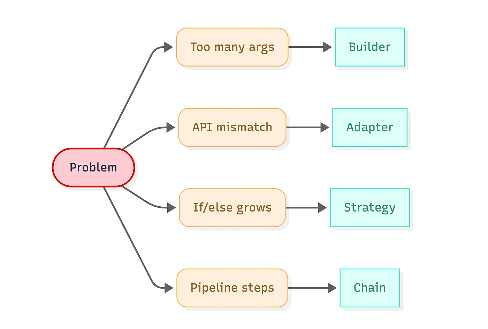
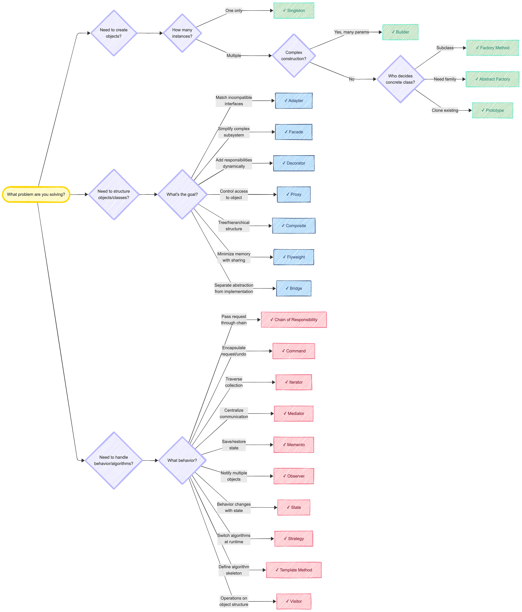

# Các topic trong project này

- design pattern
- enum
- immutable

# Refs

- https://stackjava.com/category/design-pattern
- https://gpcoder.com/4164-gioi-thieu-design-patterns

# Stop Memorizing Design Patterns: Use This Decision Tree Instead

Ref: https://medium.com/womenintechnology/stop-memorizing-design-patterns-use-this-decision-tree-instead-e84f22fca9fa

## The decision tree in three questions

Start with one question: where is the pain coming from?

Then narrow down:

1. Is the pain about creating objects?
2. Is the pain about how objects fit together?
3. Is the pain about behavior that changes across cases or over time?

These map to creational, structural, and behavioral patterns. You can ignore the categories if you want; the questions are what matter

## Branch 1: Creating objects (Creational patterns)

Use this branch when **creation logic becomes its own problem**: too many parameters, repeated setup, unclear defaults, or “which implementation should I create here?” logic spread across the codebase

- Singleton can be reasonable when the object is effectively **stateless** or safe to share (for example: a read-only config snapshot, a process-wide logger wrapper). It becomes **risky when it stores mutable state**, request context, or anything that must be reset between tests.
- When **constructors accumulate optional arguments** and configuration combinations start to matter, Builder is usually the cleanest move.
- Factory Method works well when **a base class defines a contract and subclasses decide what concrete type to create**.
- Abstract Factory fits when you need a family of related objects that must match each other.
- Prototype is useful when cloning an existing configured object is cheaper or safer than rebuilding it, especially if initialisation is expensive.

## Branch 2: Structuring objects (Structural patterns)

Use this branch when code is correct but **awkward because boundaries are unclear**: external interfaces bleed into application logic, subsystems require too many steps to use safely, or composition is hard to manage

- When your **internal code expects one interface** and an **external dependency provides another**, Adapter is the straightforward solution
  - A useful rule: keep adapters focused on **translation**. When an adapter starts containing business rules, split those rules into a separate component so the boundary stays clean.
- If a library or internal subsystem has **multiple steps that must be invoked in the right order**, introduce a Facade.
- When you need **combinations** like logging + encryption + compression + caching, subclassing becomes a combinatorial mess. Decorator gives you composition that stays local and explicit.
  - Decorator works best when each wrapper is small and predictable. If wrappers start depending on each other, it becomes difficult to reason about call order and side effects.
- Use Proxy when you want **lazy loading, caching, access control, instrumentation**, or remote calls behind a local-looking interface.
- Use Composite when your domain naturally forms a hierarchy and you want to treat leaf nodes and containers the same way.
- Flyweight matters when **many objects share identical data and duplicating it is expensive**.
  - It is less common in typical web app code, but it is worth keeping in mind for editors, renderers, or large in-memory models.
- Use Bridge when you have two dimensions of change and want to avoid a matrix of subclasses.

## Branch 3: Handling behaviour (Behavioural patterns)

Use this branch when the main issue is changing rules and workflow logic: a method accumulating if branches, an algorithm changing per customer or plan, or a pipeline that is hard to extend cleanly

- Chain of Responsibility fits middleware-style pipelines where **each step may stop processing or pass the request along**
  - Each handler should have **a single responsibility** and a clear **“stop vs continue” contract**
- Use Command when representing actions as objects gives you operational benefits: job queues, retries, audit logs, “run later” workflows, or undo stacks
- Strategy is the high-ROI answer when you have **multiple implementations of the same behaviour** and you want the caller to stay stable
- Use State when you have **well-defined modes and transitions** (connections, approval workflows, session lifecycles).
  - State reduces complex branching by making behaviour explicit per state
- Use Observer for **subscription-style updates**.
  - It can be clean, especially with domain events, but it can also hide control flow.
- Mediator can reduce coupling in **complex coordination scenarios**, especially in UI logic or workflow orchestration
- Visitor is most useful when the **structure is stable** (like an AST — Abstract Syntax Tree) and you need to add new operations without changing the structure

