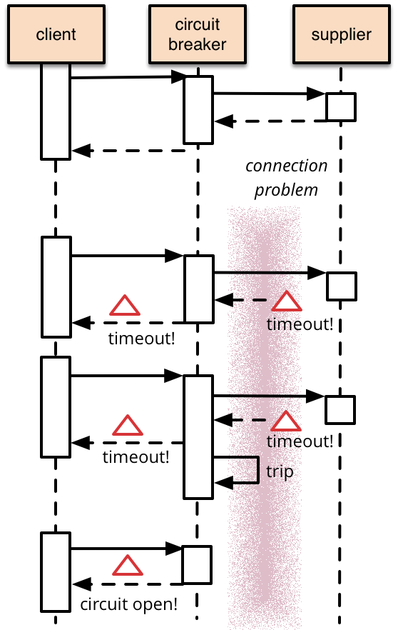

## Circuit Breaker Pattern

Summary:

- Khi cầu dao chưa hoạt động --> mạch đóng --> remote calls vẫn được phép gọi đi
- Khi cầu dao ngắt mạch (trip) --> mạch mở --> remote calls sẽ bị fail ngay lập tức

Circuit Breaker dịch một cách thô thiển gọi là cái “cầu giao”, nhiệm vụ chính của nó là ngắt mạch khi hệ thống có vấn đề “gì đó” để tránh hệ thống quá tải dẫn đến các thành phần trong hệ thống bị sụp đổ theo dẫn đến một thảm hoạ thác (cascading failures or catastrophic cascade).

Tư tưởng của Circuit Breaker là quản lý lỗi và theo dõi số lần lỗi xảy ra trong 1 khoảng thời gian và sử dụng thông tin này để quyết định xem có cho phép chương trình tiếp tục hay “ngắt mạch” ngay lập tức và trả về “exception”

Nó giống như ngắt cầu giao vậy:

- Khi cầu giao đã mở (open) thì toàn bộ chương trình sẽ không được phép gọi đến những external services nữa và trả về lỗi ngay tức thì.
- Và sau 1 khoảng thời gian “cầu giao” sẽ mở hé ra (half-open) để một vài remote calls được thực thi, nếu mọi thứ ổn tức các external services hoạt động bình thường thì toàn bộ “cầu giao” sẽ đóng lại (close) để cho chương trình có thể kết nối lại bình thường, còn nếu không cầu giao lại đóng lại ngay lập tức

3 trạng thái (state) của Circuit Breaker:

- CLOSED: khi ở trạng thái này toàn bộ chương trình hoạt động bình thường, các remote calls vẫn được phép gọi đi, nhưng khi một remote call nào đó bị Fail thì bộ đếm lỗi của CB (Circuit Breaker) kích hoạt và tăng lên 1 đơn vị. Ở đây bộ đếm lỗi (error counter) mục đích để xác định số lần fail tối đa mà hệ thống cho phép, nếu vượt quá thì CB sẽ thực hiện mở ra trạng thái OPEN
- OPEN: Ở trạng thái này các request từ ứng dụng sẽ bị Fail ngay tức thì và exception sẽ được trả về cho ứng dụng, các services từ bên ngoài sẽ bị cô lập với chương trình của chúng ta.
- HALF-OPEN: Nếu CB đang ở trạng tái OPEN sau một khoảng thời gian timeout nào đó mà chúng ta cài đặt thì CB sẽ chuyển về trạng thái HALF-OPEN (mở hé 😀) và sẽ cho phép một vài remote calls đến từ chương trình, nếu các external services hoạt động ổn thì CB sẽ chuyển về trạng thái CLOSED, còn nếu không thì CB sẽ truyển trạng thái sang OPEN và reset lại error counter. Trạng thái này hữu ích cho việc từ từ kiểm tra các remote calls đã hoạt động được không mà tránh việc mở ra ồ ạt các remote calls bằng cách chỉ cho phép một vài request đi.

Martin Fowler nói sẽ đơn giản hơn:

- You **wrap a protected function call in a circuit breaker object**, which monitors for failures.
- Once the failures reach a certain threshold, the circuit breaker trips (cầu dao ngắt mạch --> mạch hở (OPEN) --> ko cho phép kết nối với bên ngoài), and all further calls to the circuit breaker return with an error, without the protected call being made at all.
- Usually you'll also want some kind of monitor alert if the circuit breaker trips

When to use?

- Nên sử dụng ở các **ứng dụng gọi đến các dịch vụ bên ngoài hệ thống (remote service)** hoặc các tài nguyên được chia sẻ (shared resource) với tần suất lớn và có khẳ năng bị FAIL.

When NOT to use?

- Cho việc quản lý **ứng dụng gọi đến các tài nguyên nằm trong mạng của hệ thống (local private resource)** ví dụ như in-memory data hay internal services, với trường hợp này áp dụng Circuit Breaker chỉ làm cho hệ thống của bạn bị tốn tài nguyên hay overhead chứ chẳng có tác dụng gì.
- Dùng nó thay thế việc quản lý lỗi trong nghiệp vụ của ứng dụng của bạn cũng là điều không nên.

Simple code to build a Circuit Breaker manually: [CircuitBreaker](./CircuitBreaker.java)

Có rất nhiều thư viện hỗ trợ tận răng, thâm chí có cả giao diện quản lý cực kỳ cool ngầu cho CB, ví dụ như Netflix Hystrix hay Resilience4j: đừng sáng tạo lại cái bánh xe!

Ref:
- https://martinfowler.com/bliki/CircuitBreaker.html
- https://batnamv.medium.com/design-patterns-t%C3%ACm-hi%E1%BB%83u-v%E1%BB%81-ki%E1%BA%BFn-tr%C3%BAc-circuit-breaker-trong-thi%E1%BA%BFt-k%E1%BA%BF-ph%E1%BA%A7n-m%E1%BB%81m-6b158159b443
