# Design pattern

Note trong file này:

- Interface có thể thay là abstract class, interface trường hợp này muốn nói tới một kiểu trừu tượng chứ ko phải cụ thể (concrete)

# 1. Creational patterns

## Factory method

### Tên gọi khác

Virtual Constructor. Note: pattern này khác với **Simple Factory** pattern

### Intent

- Định nghĩa 1 interface để khởi tạo object ở class cha, nhưng để class con ghi đè (alter) kiểu object sẽ được khởi tạo (note: interface có thể thay bằng 1 abstract class)
- (Theo ý hiểu cá nhân t thì interface đó sẽ có 1 method tạo object Product (Product cũng là kiểu abstract), việc của class con là ghi đè method đó để tạo ra 1 kiểu concrete class của Product mà nó muốn)

Nếu bạn có 1 method khởi tạo object ở base class, và subclass extend nó và override lại method đó, thì bạn đang dùng **Factory method**!

### How to implement?

Thay vì khởi tạo trực tiếp 1 object cụ thể của interface Product bằng toán tử `new`, ta thay bằng 1 abstract method và method đó return kiểu Product. Class con sẽ phải ghi đè method đó để khởi tạo 1 concrete class Product mà nó muốn. Abstract method này được gọi là **factory method**. Ex:

```java
interface Product {}

public abstract class Client {
    public void doSomething() {
        // KHÔNG tạo mới product bằng new
        // Product prd = new Product();

        // Mà ta sẽ tạo mới Product bằng 1 factory method
        Product prd = createProduct();
        processProduct(prd);  // Do something with created product
    }

    // Đây chính là factory method, class con cần override
    public abstract Product createProduct();
}
```

### Cấu trúc

Gồm các thành phần sau:

1. **Common interface Product**: chính là interface mà chúng ta dùng Factory method pattern để khởi tạo thay vì dùng `new`, cũng chính là kiểu mà class con muốn tự tạo class cụ thể
2. **Concrete Products**: các lớp cụ thể của Product
3. Base **Creator**: Đây sẽ là khai báo **factory method**. Note: **kiểu trả về của factory method phải là kiểu Product, và method đó phải là abstract**.

   Note: công việc chính của `Creator` KHÔNG phải là khởi tạo object Product, dù nó tên là Creator. Thường thì class này sẽ xử lý business logic code liên quan đến các object Product

4. **Concrete Creators**: kế thừa từ Creator do đó nó có thể tạo các kiểu Product khác nhau

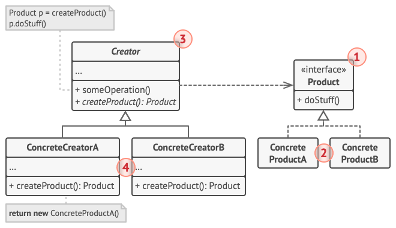

### Code example

[Xem ở đây](./factory_method/ui_elements/)

### When to use?

- **Khi bạn chưa biết trước chính xác kiểu concrete object nào bạn muốn làm việc**
  - Factory Method tách riêng code khởi tạo Product và code logic xử lý Product, do đó ta dễ dàng mở rộng, thêm mới các kiểu Product cụ thể
- Khi bạn muốn tạo thư viện/framework, cho phép user có thể mở rộng các internal component
- Khi bạn muốn sử dụng lại các object hiện có thay vì tạo mới

### Pros and Cons

Pros:

- **Tránh được tight coupling** giữa Creator và các concrete Product
- Tuân thủ **Single Responsibility Principle**: move đoạn code khởi tạo các Product ra riêng 1 chỗ
- Tuân thủ **Open/Closed Principle**: sau này nếu cần mới các kiểu concrete Product, ko cần sửa đổi Client code (đoạn code business logic xử lý Product, trong ví dụ trên là method [renderWindow()](./factory_method/ui_elements/Dialog.java))

Cons: Code khá phức tạp do có nhiều class con. Do đó, the best case scenario is when you’re introducing the pattern into an existing hierarchy of creator classes.

### Relations with Other Patterns

- Sau khi biết pattern này, bạn có thể đọc tiếp các pattern Abstract Factory, Prototype, và Builder (more flexible, but more complicated)
- Abstract Factory thường dựa trên pattern này

(Not done yet. TODO: update nốt sau khi hiểu rõ các pattern khác)

### Có sẵn trong Java:

- `java.util.Calendar#getInstance()`
- `java.text.NumberFormat#getInstance()`
- `java.nio.charset.Charset#forName()`
- `java.util.ResourceBundle#getBundle()`
- `java.net.URLStreamHandlerFactory#createURLStreamHandler(String)` (Returns different singleton objects, depending on a protocol)
- `java.util.EnumSet#of()`
- `javax.xml.bind.JAXBContext#createMarshaller()` and other similar methods.

### Ref

- https://refactoring.guru/design-patterns/factory-method
- https://refactoring.guru/design-patterns/factory-method/java/example
- https://sourcemaking.com/design_patterns/factory_method

## Simple factory

### Intent

- Định nghĩa 1 class có 1 method khởi tạo object Product dựa theo param được truyền vào
- Đây chính là pattern được giới thiệu trong cuốn **Head First Design Patterns**, [**Design pattern for dummies**](../dp_for_dummies/README.md#factory-pattern-definition)

(Note: `Product` ở đây là 1 kiểu abstract mà ta muốn khởi tạo (như đã nói ở pattern bên trên))

### How to implement?

Thông thường, pattern này chỉ có 1 method bên trong 1 class, method này sẽ nhận params rồi trả về 1 object Product dựa theo param đó. Ex:

```java
class UserFactory {
    public static function create(String type) {
        switch (type) {
            case 'user': return new User();
            case 'customer': return new Customer();
            case 'admin': return new Admin();
            default:
                throw new Exception('Wrong user type passed.');
        }
    }
}
```

### Pros and Cons

Cons: method `create` này sẽ phình to dần nếu sau này cần thêm mới nhiều kiểu object Product. Các khắc phục đơn giản là bóc tách method `create` đó thành các subclass nhỏ hơn => nó sẽ trở thành **Factory method** pattern!

### Ref

https://refactoring.guru/design-patterns/factory-comparison

## Abstract factory

Complexity: 2/3

Popularity: 3/3

### Intent

Cho phép tạo ra các **family of related objects** (họ các đối tượng liên quan đến nhau) mà ko cần chỉ rõ các concrete class của chúng

**Family of related objects** là gì? Nó là tập các object liên quan tới nhau, ví dụ như tập các abstract sau: `Chair` + `Sofa` + `CoffeeTable`. Các biến thể concrete của tập này có thể là

- `ArtDecoChair` + `ArtDecoSofa` + `ArtDecoCoffeeTable` (biến thể ArtDeco)
- `VictorianChair` + `VictorianSofa` + `VictorianCoffeeTable` (biến thể Victorian)
- `ModernChair` + `ModernSofa` + `ModernCoffeeTable` (biến thể Modern)

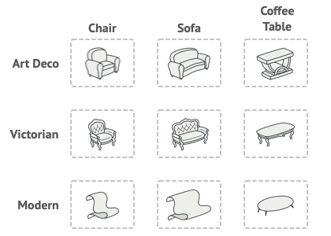

Mỗi biến thể trên được gọi là **variant of a product family** (biến thể của 1 họ các Product)

Tức là, common interface Product**s** của bạn sẽ gồm 3 interface `Chair` + `Sofa` + `CoffeeTable`, và Client có thể tạo các concrete class của tập này là 3 tập trên, và chú ý là sẽ KHÔNG có trường hợp mix, chẳng hạn `ArtDecoChair` + `VictorianSofa` + `VictorianCoffeeTable` hay `ModernChair` + `ArtDecoSofa` + `ModernCoffeeTable`.

Nếu chương trình của bạn ko dùng tới family of related objects, thì bạn ko cần dùng pattern **Abstract factory**

> And again, a lot of people mix-up the **abstract factory** pattern with a **simple factory** class declared as abstract. Don't do that!

(Hãy tưởng tượng bạn đang thiết kế một game thế giới mở cực hoành tráng, và hiện tại dự án đang đến đoạn thiết kế furniture shop :v)

### How to implement?

- Khai báo từng kiểu common interface Product (vd trên có 3 Product: `Chair`, `Sofa`, `CoffeeTable`)
- Tạo các kiểu concrete Product cho các interface trên, ex:
  ```java
  public interface Chair {}
  public class ArtDecoChair implements Chair {}
  ```
- Khai báo **Abstract Factory**, bao gồm các **factory method** dùng để khởi tạo các interface trên (factory method, như nói ở pattern trước, chỉ đơn giản là method return kiểu Product), ex:
  ```java
  public interface FurnitureFactory {
      public abstract Chair createChair();
      public abstract Sofa createSofa();
      public abstract CoffeeTable createCoffeeTable();
  }
  ```
- Tạo từng concrete factory cho từng biến thể của họ Product, ex:
  ```java
  // Factory cho biến thể ArtDeco: CHỈ CÓ THỂ tạo các object thuộc kiểu ArtDeco
  public class ArtDecoFactory implements FurnitureFactory {
      public abstract Chair createChair() {
          return new ArtDecoChair();
      }
      public abstract Sofa createSofa() {
          return new ArtDecoSofa();
      }
      public abstract CoffeeTable createCoffeeTable() {
          return new ArtDecoCoffeeTable();
      }
  }
  ```

Với các làm trên, bất kỳ biến thể nào của `Chair` được return từ concrete factory, nó sẽ luôn match với kiểu `Sofa` và `CoffeeTable` được sản xuất bởi factory đó

### Cấu trúc

1. **Abstract Products**: khai báo các kiểu interface cho family of product (tập các product liên quan đến nhau)
2. **Concrete Products**: concrete Products, được nhóm thành các **variant of a product family** (các biến thể của tập các Product) khác nhau. (Tức là: 1 tập biến thể gồm nhiều concrete Product)
3. **Abstract Factory**: một interface khai báo các factory method cho việc khởi tạo các Product. Note: các method này phải return các **abstract** Product chứ ko phải các concrete Product
4. **Concrete Factories**: implement Abstract Factory, chúng sẽ override các factory method để tạo ra các concrete Product **cùng loại** (cùng family)

### Code example

[Xem ở đây](./abstract_factory/furniture_shop/)

### So sánh Abstract factory (AF) vs Factory method (FM)

- AF gồm tập family of products, còn FM chỉ có 1 interface Product

  

- Factory của AF giống với Creator của FM, cả 2 đều là abstract và cả 2 pattern đều chỉ có 1 thành phần này. Tuy nhiên, factory của AF có nhiều **factory method** vì AF có nhiều Product, trong khi FM chỉ có 1

  

- Concrete factories của AF giống với concrete creators của FM

  

### When to use?

- Khi bạn phải làm việc với nhiều tập **family of related products**, nhưng bạn ko muốn phụ thuộc vào các concrete Product của tập đó
  - Pattern này giúp bạn tránh được việc tạo ra các biến thể ko đúng (biến thể gồm các Product khác kiểu với nhau), chẳng hạn: `ArtDecoChair` + `ModernCoffeeTable`
  - Khi có nhiều kiểu Product, bạn nên **extract từng factory method thành từng factory class riêng biệt**

### Pros and Cons

Pros:

- Các Product được tạo bởi 1 factory sẽ tương thích với nhau (vì chúng cùng variant)
- Tránh được tight coupling giữa concrete Products và Client code
- Tuân thủ **Single Responsibility Principle**: move đoạn code khởi tạo các Product ra riêng 1 chỗ
- Tuân thủ **Open/Closed Principle**: sau này nếu cần mới các biến thể của các Product, ko cần sửa đổi Client code (ex: chỉ cần thêm mới Factory và khai báo mới các Product, còn code business logic được xử lý trong method [testFurniture()](./abstract_factory/furniture_shop/App.java))

Cons: code trở lên phức tạp hơn vì có nhiều interface và class

### Relations with Other Patterns

- Các class của **Abstract Factory** thường dựa trên 1 tập các **Factory Methods**
- ...

### Ref

- https://refactoring.guru/design-patterns/abstract-factory
- https://refactoring.guru/design-patterns/factory-comparison

# 2. Structural Patterns

## Adapter

Tên gọi khác: Wrapper

### Intent

Giúp các object không cùng kiểu interface có thể giao tiếp với nhau

Adapter sẽ implement interface của 1 object và wrap object còn lại. Nói cách khác, adapter sẽ convert kiểu interface này sang kiểu interface kia để client có thể dùng được

Bài toán: bạn có ứng dụng chứng khoán, thu thập data từ nhiều nguồn dưới format XML rồi vẽ thành chart hiển thị cho user. Giờ bạn muốn tích hợp thêm thư viện analytics, nhưng thư viện đó chỉ làm việc với JSON. Bạn không thể thay đổi thư viện để bắt nó nhận input XML

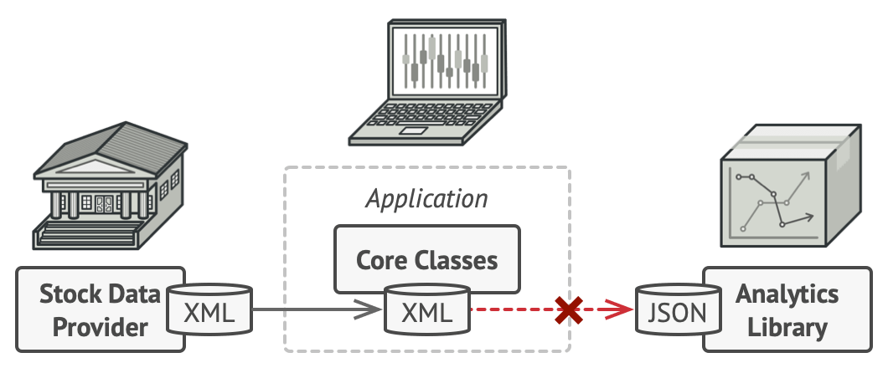

Solution: dùng adapter để convert XML data từ provider sang dạng JSON


Adapters can not only **convert data into various formats** but can also **help objects with different interfaces collaborate**. Here’s how it works:

- The adapter **gets an interface**, compatible with one of the existing objects.
- Using this interface, the **existing object can safely call the adapter’s methods**.
- Upon receiving a call, the **adapter passes the request to the second object**, but in a format and order that the second object expects.

Sometimes it’s even possible to create a **two-way adapter** that can convert the calls in both directions.

### Cấu trúc

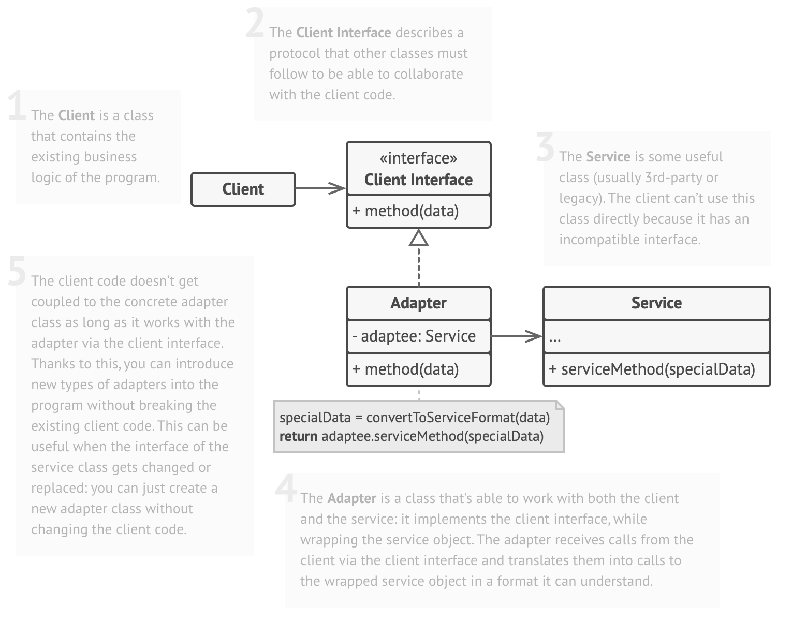

Gồm các thành phần sau:

1. `Client`: là class muốn dùng interface không tương thích. Như ví dụ trên thì client chính là Application. 2 interface không tương thích vs nhau là `ClientAnalytics` và `AnalyticsLibrary`, hiện tại client chỉ làm việc được với XmlStock
2. `Client Interface`: code cũ của client, làm việc với data format cũ, trong code là `ClientAnalytics`
3. `Service`, hay `Adaptee`: chính là interface mà client muốn dùng, nhưng không thể dùng trực tiếp được, thường là 3rd-party code. Trong code là `AnalyticsLibrary`
4. `Adapter`: là class làm việc với cả 2 interface trên, nó sẽ **implement 1 interface** (client interface), và **wrap library interface**. Khi client gọi tới adapter, nó sẽ convert format của client sang format mà library hiểu được, rồi gọi tới method của library

Túm lại thì:

- Có 2 InterfaceA và InterfaceB muốn làm việc với nhau
- InterfaceA cần gọi sang InterfaceB
- Method của InterfaceA nhận inputA, trong khi method của InterfaceB nhận inputB
- **InterfaceA KHÔNG thể call trực tiếp được InterfaceB**
- Tạo **Adapter implement InterfaceA**, adapter này sẽ **convert inputA sang inputB**, sau đó dùng inputB này **gọi tới InterfaceB**
- Adapter sẽ phải **implement 1 interface, và wrap 1 interface còn lại**

Nhận xét: sao không viết mỗi 1 method để convertXmlToJson, xong gọi tới library luôn cho nhanh, phải tạo mới interface để làm gì???

### Pros and Cons

Pros:

- Single Responsibility Principle: tách phần convert data ra khỏi business logic
- Open/Closed Principle: tạo mới adapter để không phải sửa đổi code của client, miễn là client làm việc với adapter thông qua ClientInterface

Cons: tăng độ phức tạp do tạo thêm interface và class. Nếu có thể thì hãy sửa trực tiếp code của Adaptee cho đơn giản

## Decorator

Tên gọi khác: Wrapper

### Intent

Giúp thêm behavior vào object bằng cách wrap object đó trong 1 wrapper chứa sẵn các behavior cần thêm đó

Bài toán: giả sử bạn muốn thiết kế 1 thư viện gửi thông báo cho client (application) dùng, nó có 1 method `send` trông như này

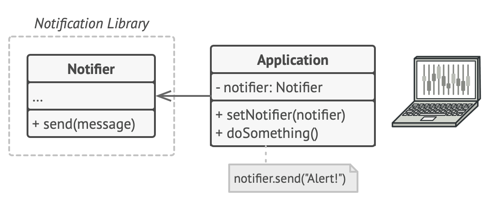

Việc gửi notification có thể thông qua nhiều cách như này:

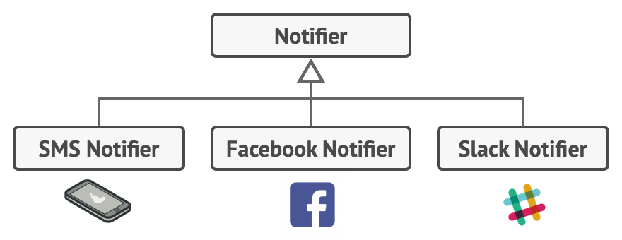

Khá đơn giản, bạn chỉ việc tạo 3 concrete Notifier như hình là được, sau đó client muốn dùng cái nào thì gọi. Nhưng giờ client muốn flexible hơn, lúc thì muốn gửi thông báo tới SMS + Slack, lúc thì muốn gửi qua FB + Slack, bạn nghĩ lại phải tạo từng concrete combined Notifier ứng với từng case như vậy

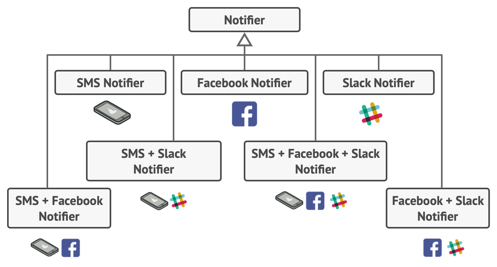

Tại sao, vì nếu cứ dùng 1 cái riêng lẻ, thì mỗi lần gửi thông báo lại phải send nhiều lần:

```java
Notifier notifier1 = new EmailNotifier(recipients);
Notifier notifier2 = new SmsNotifier(recipients);
Notifier notifier3 = new SlackNotifier(recipients);

// One place
notifier1.send(message);
notifier2.send(message);
notifier3.send(message);

// Another place also need to send notification
notifier1.send(message);
notifier2.send(message);
notifier3.send(message);

// Using a combined notifier would be easier to send
Notifier notifier = new EmailSmsSlackNotifier
notifier.send("Your account has been locked");
notifier.send("Another message");
```

Nhưng nếu dùng class combine đó, trông không ổn chút nào, nếu thêm 1 channel để gửi thông báo nữa, thì phải tạo nhiều class combine nữa!

Solution: **Extending** a class is the first thing that comes to mind when you need to **alter an object’s behavior**. However, **inheritance has several serious caveats** that you need to be aware of (kế thừa cần chú ý những điều sau)

- **Inheritance is static**. You **can’t alter the behavior of an existing object** at runtime. You **can only replace the whole object** with another one that’s created from a different subclass.
- **Single inheritance**: Subclasses can have just one parent class. In most languages, inheritance doesn’t let a class inherit behaviors of multiple classes at the same time

Để vượt qua caveat trên, có thể dùng:

- Aggregation:
  - Object A contains object B
  - B can live without A
- Composition:
  - Object A consists of object B
  - A manages lifecycle of B
  - B can NOT live without A

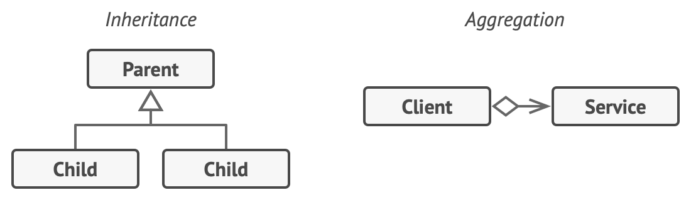

Decorator sẽ dùng Composition: nó sẽ wrap 1 target object bên trong (object này được gọi là wrappee, decorator là wrapper). Wrapper sẽ delegate work cho wrappee, nhưng sẽ làm thêm việc gì đó trước hoặc sau khi delegate

The wrapper **implements the same interface** as the wrapped object (wrappee) => That’s why from the client’s perspective these objects are identical.

Hãy để wrappee (reference field của wrapper) có thể là bất kỳ object nào thuộc kiểu interface đó, như vậy ta có thể bọc 1 target object bằng nhiều wrapper ở ngoài => có thể thêm nhiều behavior hơn

(Make the wrapper’s reference field accept any object that follows that interface. This will let you cover an object in multiple wrappers, adding the combined behavior of all the wrappers to it)

Với bài toán trên, ta sẽ thiết kế lại như này:

- `BaseDecorator` sẽ là abstract class, chứa wrappee và đã implement method send của interface `Notifier` (nó implement đơn giản là delegate cho wrappee thôi). (Việc tạo base này không cần thiết nhưng nên tạo để tránh duplicate code, các concrete decorator không phải viết lại logic method send nữa)
- Các concrete decorator sẽ extend từ `BaseDecorator`, override lại method send: chúng sẽ không cần implement lại detail method send nữa, chỉ cần gọi `super.send()` là được, sau đó thêm extra behavior vào

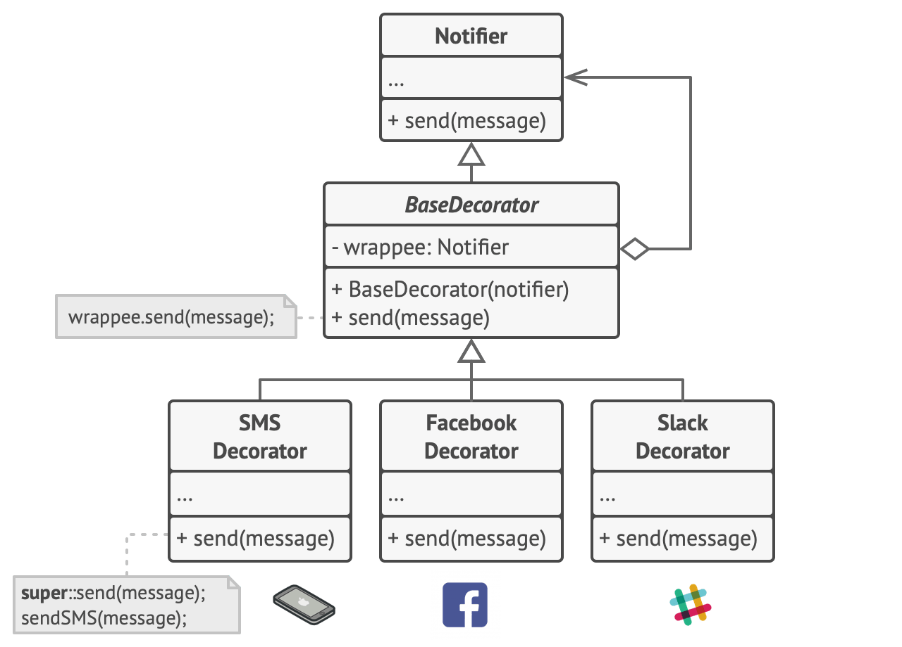

Cụ thể code: [BaseNotifier](./decorator/notification/libs/decorator/BaseNotifier.java)

### Cấu trúc

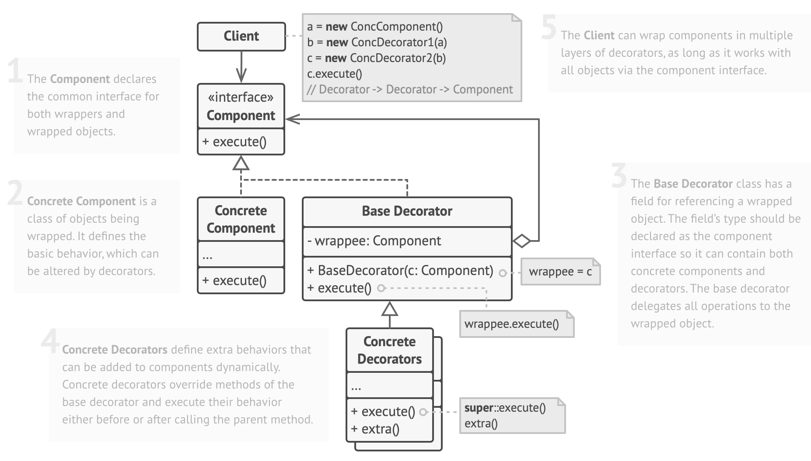

Gồm các thành phần sau:

1. Interface `Component`, là interface chung cho cả wrapper và wrappee (target object). Trong code là [`Notifier`](./decorator/notification/libs/Notifier.java)
2. Các `ConcreteComponent`, implement cụ thể của `Component`, chúng là các wrappee, sẽ bị wrap bởi decorator. Trong code là [`EmailNotifier`](./decorator/notification/libs/impl/EmailNotifier.java), `FacebookNotifier`...
3. `BaseDecorator`: abstract class, chứa wrappee có kiểu `Component`, field này nên là kiểu interface thay vì kiểu cụ thể, để các decorator khác có thể wrap tiếp được. `BaseDecorator` sẽ delegate work cho wrappee (wrapped object). Trong code là [BaseNotifier](./decorator/notification/libs/decorator/BaseNotifier.java)
4. `ConcreteDecorator`: kế thừa `BaseDecorator`, nó sẽ override lại method `execute` của cha bằng cách gọi method đó của cha, cộng với extra behavior của riêng nó. Trong code là [`EmailDecorator`](./decorator/notification/libs/decorator/EmailDecorator.java)...
5. `Client`: wrap component bằng nhiều lớp khác nhau, mỗi lớp là 1 decorator mà client muốn thêm tính năng cho component ban đầu

### Pseudocode

Bài toán 2: compress and encrypt sensitive data independently from the code that actually uses this data

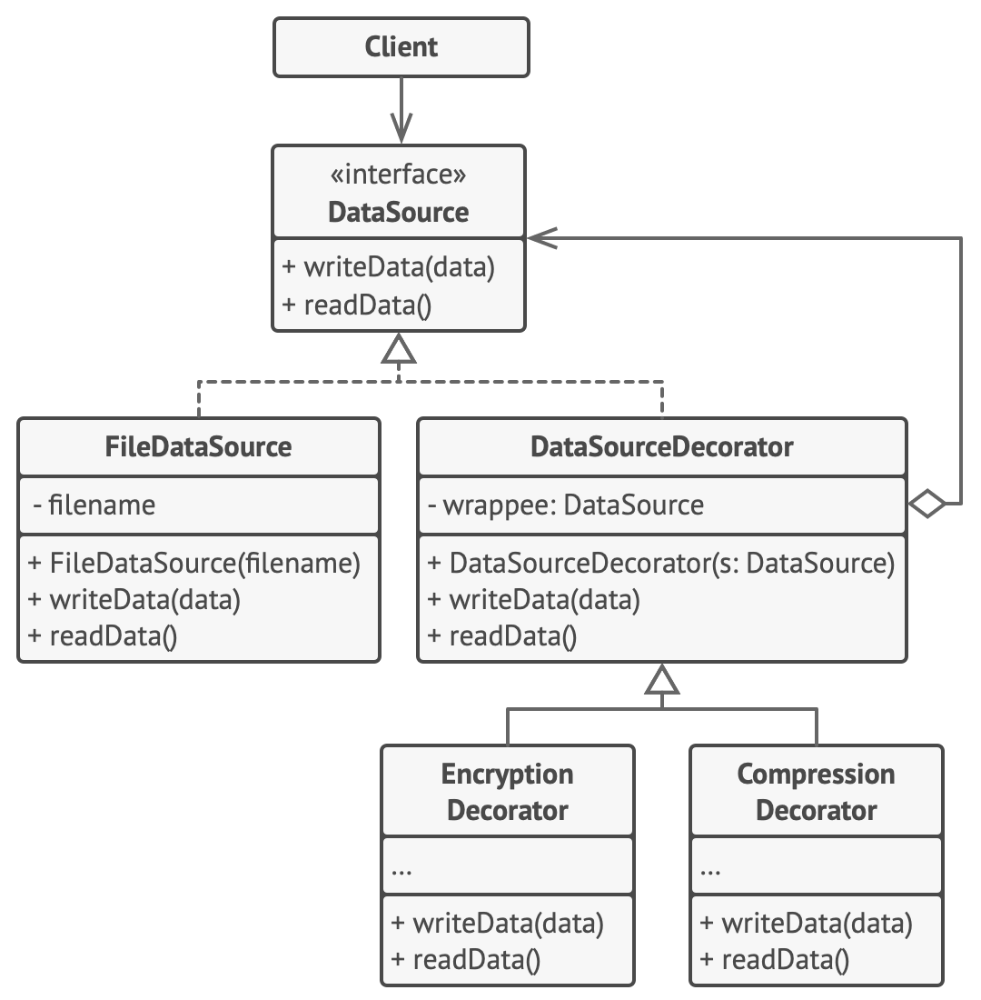

Initially, the business logic class could only read and write data in plain text. Then we created several small wrapper classes that add new behavior after executing standard operations in a wrapped object.

The first wrapper encrypts and decrypts data, and the second one compresses and extracts data.

You can even combine these wrappers by wrapping one decorator with another.

Trong ví dụ này, ta có:

- `DataSource`: common interface để đọc và ghi vào file
- `FileDataSource`: concrete dataSource, sẽ implement việc đọc ghi file nhưng chỉ dưới dạng plain text. Ta sẽ tạo thêm decorator để thêm behavior cho object này. Object thuộc kiểu này sẽ là wrappee, và nó sẽ được wrap bởi các decorator khác
- `EncryptionDecorator`, `CompressionDecorator`: 2 decorator giúp thêm các hành vi mã hoá và nén trước/sau khi ghi vào file.
- Hiển nhiên việc đọc ghi file là bắt buộc, việc thêm mã hoá hay nén chỉ là phụ. Ta không thể nén hoặc mã hoá mà không đọc ghi. Do đó `FileDataSource` sẽ là wrappee, còn 2 thằng kia là decorator. Ta cũng KHÔNG có `FileDecorator`, `EncryptionDataSource` hay `CompressionDataSource`
- Ví dụ này hơi khác với ví dụ notifier:
  - Bên Notifier sẽ tạo tất cả các concrete component (wrappee) và các concrete decorator, vì các object đó ngang hàng nhau
  - Ví dụ này do việc đọc ghi file là bắt buộc, mã hoá và nén chỉ là phụ, nên không cần tạo tất

### Pros and Cons

Pros:

- You can extend an object’s behavior without making a new subclass.
- You can **add or remove responsibilities** from an object at runtime.
- You can combine several behaviors by wrapping an object into multiple decorators.
- **Single Responsibility Principle**. You can divide a monolithic class that implements many possible variants of behavior into several smaller classes.

Cons:

- It’s **hard to remove a specific wrapper** from the wrappers stack.
- It’s **hard to implement a decorator** in such a way that its behavior doesn’t depend on the order in the decorators stack.
  - Cái này theo t hiểu là thứ tự wrap đôi khi rất quan trọng.
  - Ví dụ bạn có 2 decorator: encrypt và compress. Nếu bạn wrap theo thứ tự: compress rồi encrypt, thì khi đọc file bạn phải decrypt rồi extract.
  - Còn nếu wrap theo thứ tự ngược lại: encrypt rồi compress, thì khi đọc file bạn phải extract rồi decrypt. Như vậy thứ tự wrap rất quan trọng.
  - Ví dụ 2: giống như mặc nhiều lớp áo vậy: phải mặc áo len trước khi mặc áo mưa!
- The initial configuration code of layers might look pretty ugly.

### Relations with Other Patterns

About the target object:

- With Adapter you access an existing object via different interface.
- With Proxy, the interface stays the same.
- With Decorator you access the object via an enhanced interface

Structure, intent: Decorator and Proxy have similar structures, but very different intents.

- Both patterns are built on the composition principle, where one object is supposed to delegate some of the work to another.
- The difference is that a **Proxy usually manages the life cycle of its service object on its own**, whereas the **composition of Decorators is always controlled by the client**.

Ref: https://refactoring.guru/design-patterns/decorator

## Proxy

Complexity: 2/3

Popularity: 1/3

### Intent

This pattern provides a substitute or placeholder for another object. A proxy controls access to the original object, allowing you to perform something either before or after the request gets through to the original object

Proxy là 1 object thay thế cho 1 object khác (trong JS gọi là target). Ta sẽ giao tiếp với proxy thay vì target object. Proxy giúp quản lý access tới target object (chẳng hạn validate, authenticate hay check cache trước khi cho request truy cập vào object thực sự (target))

Bài toán: ứng dụng có rất nhiều client connect tới database, và ta muốn dùng lazy initialization: khởi tạo object khi cần chứ không khởi tạo tất cả object khi startup.

- Ta có thể sửa code của các client và implement lazy init ở đây, tuy vậy sẽ có rất nhiều duplicated code.
- Ta cũng có thể implement lazy init ở class kết nối đến db (classA), nhưng có trường hợp class này của thư viện và ta không sửa code được (có thể hình dung ở hình dưới, classA chính là service đứng ngay trước DB, nó sẽ kết nối và query trực tiếp tới db, client code sẽ gọi tới classA này nếu muốn thao tác tới db)

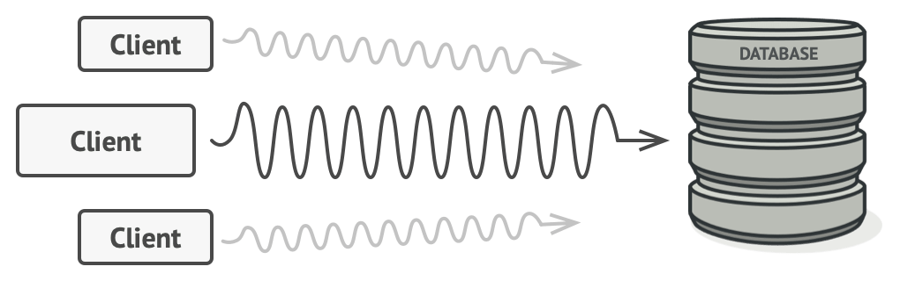

Solution:

- Tạo mới 1 proxy class, với target class chính là object classA ở trên (object connect tới db)
- Object proxy là sẽ thực hiện việc lazy init
- Sau khi init xong, nó sẽ delegate công việc còn lại xuống classA

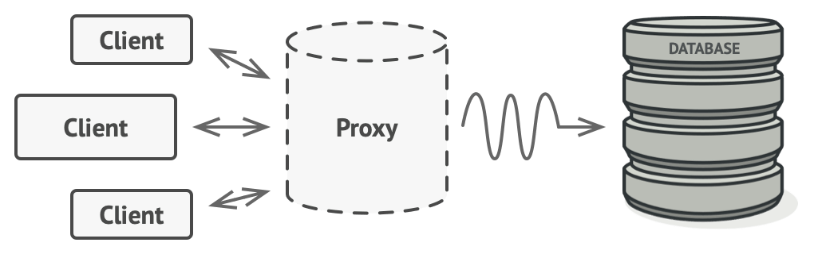

### Cấu trúc

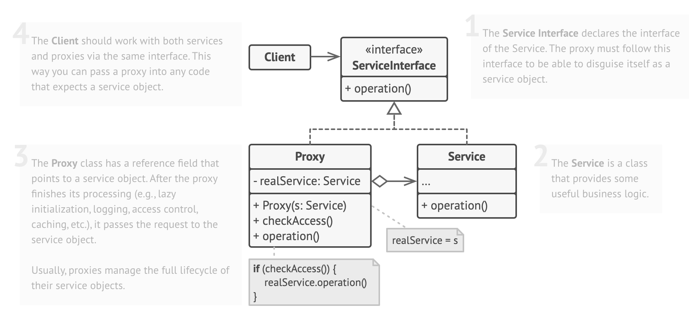

Gồm các thành phần sau (để dễ hiểu, target object ở đây là khái niệm bên JS, là object mà Proxy wrap bên trong. Target object còn được gọi là **Real object**)

1. `Service Interface`: interface chung cho target object và Proxy.
2. `Service`: là object mà ta muốn tạo proxy cho nó, đây chính là target object của object Proxy. Như ví dụ trước thì object này chính là classA, nó handle logic tới database
3. `Proxy`:
   - Đây là class proxy như đã nói ở trên, client sẽ connect với class này thay vì connect trực tiếp tới `Service` (classA).
   - Class này sẽ chứa 1 target object, chính là object `Service` implement `Service Interface`
   - Sau khi Proxy thực hiện xong nhiệm vụ của nó (method `checkAccess()`, method này có thể thực thi: lazy init, logging, access control...), nó sẽ delegate request xuống `Service` (gọi method `operation()`)
4. `Client`: dùng `Proxy` object thay vì `Service` object

### Ứng dụng

- **Lazy initialization** (virtual proxy): Instead of creating the object when the app launches, you can delay the object’s initialization to a time when it’s really needed
- **Access control** (protection proxy). This is when you want only specific clients to be able to use the service object (target)
- Local execution of a remote service (**remote proxy**): the proxy passes the client request over the network, handling all of the nasty details of working with the network
- **Logging** requests (logging proxy): The proxy can log each request before passing it to the service
- **Caching** request results (caching proxy)

### Pros and Cons

Pros:

- **Control** the service object without clients knowing about it
- **Manage the lifecycle** of the service object
- The proxy works even if the service object isn’t ready or is not available.
- **Open/Closed Principle**. You can **introduce new proxies without changing the service or clients**.

Cons:

- The code may become **more complicated** since you need to introduce a lot of new classes.
- The response from the service might get **delayed**.

### Relations with Other Patterns

Updating...
